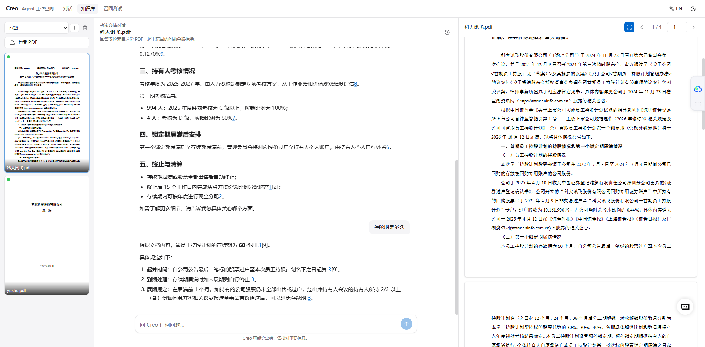
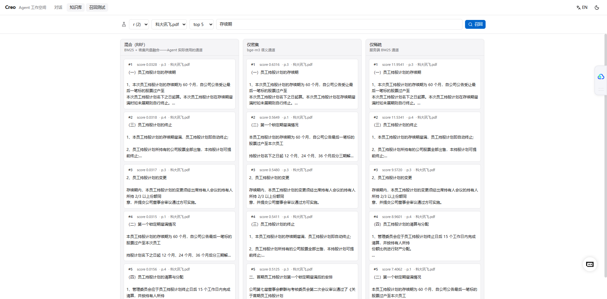
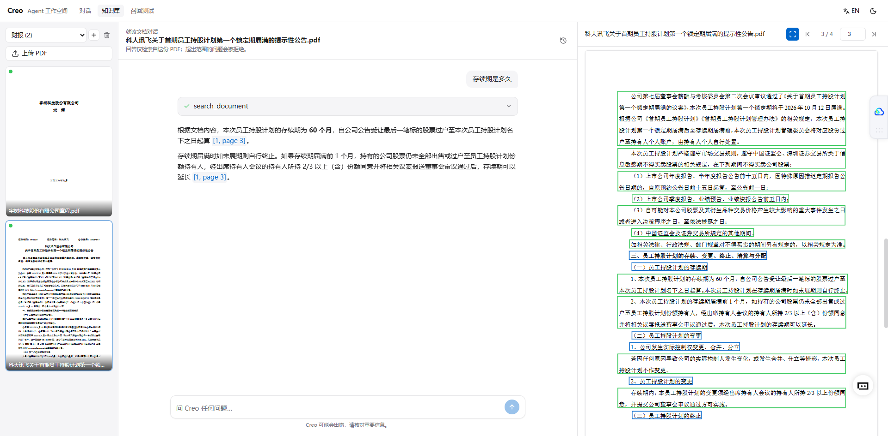
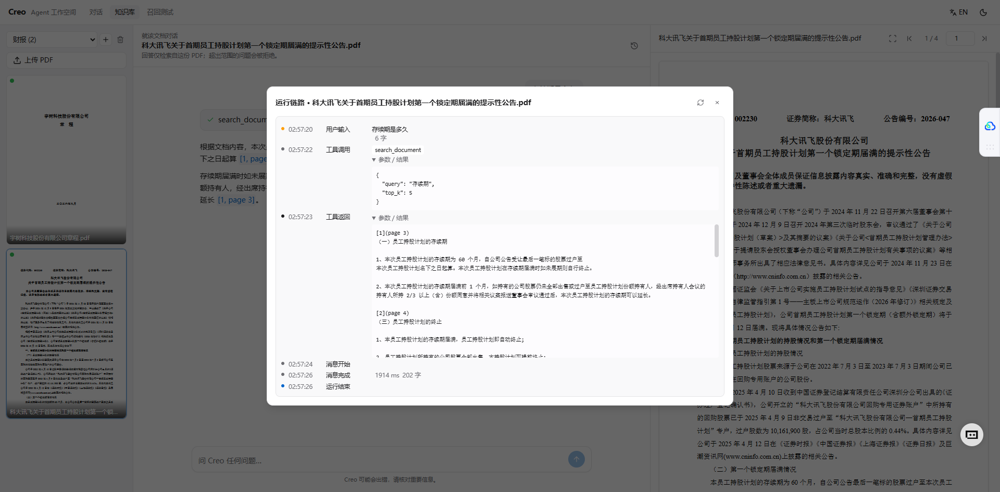

# Creo

> A modern workspace for AI agents.
>
> *Creo* comes from Latin **creō** — to create, to bring forth, to make something come into being.

English | [中文文档](README_zh.md)

Creo is in its **MVP stage**: the goal is not feature count, but a stable, clear and extensible agent foundation. Future capabilities (Knowledge / RAG / MCP / Multi-Agent / Workflow) evolve on top of this base.

## Core Flow

```text
User
  ↓
React Agent UI
  ↓
SSE / HTTP
  ↓
FastAPI
  ↓
DeepAgents
  ↓
LLM
  ↓
Tools
  ↓
Result
```

## Features

- Streaming chat with a DeepAgents-backed agent (SSE, token-level streaming)
- Session management, tool call visualization (running / success / error)
- Markdown rendering with code blocks, light / dark theme
- **Knowledge base (v1)**: create categorized knowledge bases, upload PDFs, and let the agent retrieve them with **hybrid search — dense vectors (bge-m3) + sparse BM25** served by Milvus / Zilliz Cloud

## Screenshots

| Document chat · citations · PDF preview | Recall test — hybrid vs dense vs sparse |
| --- | --- |
|  |  |

| Agent answer with tool call · element-box overlay on the PDF | Run trace — per-event timeline |
| --- | --- |
|  |  |

## Tech Stack

| Layer | Technology |
| --- | --- |
| Frontend | React 19 · TypeScript (strict) · Vite · React Router · Tailwind CSS · shadcn-style components · lucide-react · pnpm |
| Backend | Python 3.12+ · FastAPI · DeepAgents · Pydantic · SSE · uv |
| Knowledge base | Unstructured (self-hosted parsing API) · Milvus / Zilliz Cloud (server-side BM25 + dense vectors, `pymilvus`) · OpenAI-compatible embeddings |
| Protocol | Creo Agent Event Protocol (custom event protocol; the frontend never touches DeepAgents internals) |

## Directory Structure

```text
creo/
├── README.md            # This file
├── README_zh.md         # Chinese documentation
├── AGENTS.md            # Development rules (required reading for humans & AI agents)
├── DESIGN.md            # UI design system
├── CONTRIBUTING.md      # Development process & commit rules
├── scripts/             # Boundary checks & pre-commit helper
├── docs/
│   ├── architecture.md  # Architecture guide
│   ├── decisions/       # ADRs (architecture decision records)
│   ├── development/     # CHANGELOG / TECHNICAL-NOTES / PITFALLS
│   └── milestones/      # MVP acceptance criteria & status
├── frontend/            # React agent UI
└── backend/             # FastAPI + DeepAgents runtime
```

## Quick Start

### Prerequisites

- Node.js ≥ 20.19 (22 recommended) + **pnpm 12** (`corepack enable` or `npm i -g pnpm`)
- Python ≥ 3.12 and [uv](https://docs.astral.sh/uv/)
- One LLM API key (any provider; OpenAI-compatible endpoints are supported via a custom base_url)
- For the knowledge base (optional): a [Zilliz Cloud](https://zilliz.com/cloud) cluster or self-hosted Milvus ≥ 2.5, an [Unstructured](https://transform.unstructured.io) Transform API key, and an embedding API key (e.g. `BAAI/bge-m3` on SiliconFlow)

### 1. Backend

```bash
cd backend
cp .env.example .env          # fill in your model / API keys (see below)
uv sync
uv run uvicorn app.main:app --reload --port 8000
```

Health check: <http://localhost:8000/api/health> (the `model` field shows the active config); API docs: <http://localhost:8000/docs>

### 2. Configure the LLM

Everything lives in `backend/.env`. Provider / model / base_url / api_key are all customizable — any OpenAI-compatible service works (DeepSeek, Qwen, Moonshot, Ollama, vLLM…):

```ini
CREO_MODEL_PROVIDER=openai
CREO_MODEL_NAME=gpt-4o-mini
OPENAI_API_KEY=sk-...

# Example: DeepSeek — OpenAI-compatible services only need NAME / BASE_URL / API_KEY
# CREO_MODEL_NAME=deepseek-chat
# CREO_MODEL_BASE_URL=https://api.deepseek.com/v1
# CREO_MODEL_API_KEY=sk-...
```

### 3. Frontend

```bash
cd frontend
pnpm install
pnpm run dev
```

Open <http://localhost:5173> (in dev mode `/api` is proxied by Vite to the backend on port 8000).

### Docker (optional)

```bash
# Prepare .env at the repo root (model / key config is injected into the backend by compose)
docker compose up --build
```

Open <http://localhost:5173>.

## Development

Backend — tests and lint:

```bash
cd backend
uv run pytest            # tests
uv run ruff check .      # lint
```

Frontend — typecheck (strict), lint, tests:

```bash
cd frontend
pnpm run typecheck       # tsc --noEmit
pnpm run lint            # eslint
pnpm run test            # vitest
pnpm run build           # production build
```

One-shot pre-commit check (architecture boundaries, design tokens, backend ruff + pytest, frontend typecheck + lint + test + build):

```bash
bash scripts/pre-commit-check.sh

# Optional: run it automatically on every git commit
git config core.hooksPath .githooks
```

## Knowledge Base Setup (Optional)

The knowledge base ships **disabled**. Set `CREO_KB_ENABLED=true` and fill in the three endpoints below; if anything is missing — or Milvus cannot be reached at startup — the KB stays disabled (endpoints return `503`, the retrieval tool is not registered) and the chat flow is unaffected.

### 1. Milvus / Zilliz Cloud (vectors + full-text)

```ini
CREO_MILVUS_URI=https://in03-xxxx.api-us-west-1.zillizcloud.com   # cluster endpoint
CREO_MILVUS_TOKEN=                                                # Zilliz Cloud API key
# Self-hosted Milvus instead: CREO_MILVUS_URI=http://localhost:19530
```

- Zilliz Cloud: create a Dedicated cluster, copy the endpoint from the cluster page and an API key from the API Keys page. Server-side BM25 requires Milvus ≥ 2.5 (all current Zilliz Cloud clusters qualify).
- Each knowledge base gets its own collection (`kb_{slug}_{id}`); collections are created lazily on first ingest.
- Index types are chosen automatically: `AUTOINDEX` on Zilliz Cloud (dedicated & serverless), explicit `SPARSE_INVERTED_INDEX` + BM25 on self-hosted Milvus.

### 2. Unstructured Transform API (PDF parsing)

```ini
CREO_UNSTRUCTURED_API_KEY=          # API key from the Unstructured platform
# CREO_UNSTRUCTURED_SERVER_URL=https://transform.unstructured.io
# CREO_UNSTRUCTURED_PROFILE=best    # balanced | best | fast (best ≈ hi_res quality)
```

Parsing goes through Unstructured's Transform API via the official `unstructured-transform-client` SDK. Creo requests structured elements (one-based page numbers, table HTML) and does the chunking **client-side**: consecutive elements are packed to ~1500 characters, tables stay standalone with their HTML. `best` is the quality tier (handles scanned PDFs); `balanced` is faster and cheaper.

### 3. Embeddings (dense channel)

```ini
CREO_KB_EMBEDDING_BASE_URL=https://api.siliconflow.cn/v1   # any OpenAI-compatible /embeddings
CREO_KB_EMBEDDING_API_KEY=
CREO_KB_EMBEDDING_MODEL=BAAI/bge-m3
CREO_KB_EMBEDDING_DIM=1024
```

### 4. Use It

1. Open the **Knowledge** page (top navigation) → create a knowledge base (this is the "category"; each KB = a local folder + one Milvus collection).
2. Upload PDFs — parsing, chunking and indexing run in the background; rows poll from `pending → processing → ready / failed`, failed documents can be re-ingested with one click. Every stage (upload/parse/chunk/embed/index) is recorded — open the **trace timeline** on a document row to see durations and details. Paid stages (parse, embed) are content-addressed cached under `backend/data/kb/_cache/`, so re-ingesting the same file never re-spends API quota.
3. **Preview** a document inline (pdf.js rendering with page navigation) or read it in **Chat** — the agent calls `search_knowledge_base` (hybrid BM25 + dense retrieval, RRF fusion) and cites `[1] filename (page N)` sources. Retrieval calls show up as regular tool cards in the UI.

### Knowledge Base Notes

- The embedding model, dimension and the Chinese analyzer (`CREO_KB_ANALYZER=chinese`, jieba-based) are **fixed when a collection is created**. Changing them means dropping the KB and re-ingesting.
- Uploaded files and the SQLite registry live under `backend/data/kb/` (git-ignored).
- If the backend restarts mid-ingestion, documents may stay in `processing` — use the retry button to re-ingest (idempotent: old vectors are deleted first).

## Configuration Reference

All variables use the `CREO_` prefix and are set in `backend/.env` (see `.env.example` for the annotated list).

| Variable | Default | Description |
| --- | --- | --- |
| `CREO_MODEL_PROVIDER` | `openai` | Any provider known to `init_chat_model` |
| `CREO_MODEL_NAME` | `gpt-4o-mini` | Model name |
| `CREO_MODEL_API_KEY` | — | Optional; falls back to provider-native env keys |
| `CREO_MODEL_BASE_URL` | — | Optional; for OpenAI-compatible endpoints |
| `CREO_AGENT_INSTRUCTIONS` | built-in | Agent system prompt |
| `CREO_CORS_ORIGINS` | localhost:5173 | Comma-separated allowed origins |
| `CREO_LOG_LEVEL` | `INFO` | stdlib logging level |
| `CREO_KB_ENABLED` | `false` | Master switch for the knowledge base |
| `CREO_MILVUS_URI` | — | Zilliz Cloud endpoint or `http://host:19530` |
| `CREO_MILVUS_TOKEN` | — | Zilliz Cloud API key (empty for unauthenticated self-hosting) |
| `CREO_UNSTRUCTURED_API_KEY` | — | Unstructured Transform API key (required for the KB) |
| `CREO_UNSTRUCTURED_SERVER_URL` | `https://transform.unstructured.io` | Override for other deployments; a trailing `/api/v2` is stripped automatically (legacy name `CREO_UNSTRUCTURED_API_URL` still accepted) |
| `CREO_UNSTRUCTURED_PROFILE` | `best` | Parsing tier: `balanced` \| `best` \| `fast` |
| `CREO_KB_EMBEDDING_BASE_URL` | — | OpenAI-compatible `/embeddings` base URL |
| `CREO_KB_EMBEDDING_API_KEY` | — | Bearer token |
| `CREO_KB_EMBEDDING_MODEL` | `BAAI/bge-m3` | Embedding model |
| `CREO_KB_EMBEDDING_DIM` | `1024` | Vector dimension (must match the model) |
| `CREO_KB_ANALYZER` | `chinese` | BM25 analyzer; `chinese`/`english`/`standard` or a JSON analyzer_params |
| `CREO_KB_CHUNK_MAX_CHARACTERS` | `1500` | Max characters per chunk |
| `CREO_KB_CHUNK_STRATEGY` | `pack` | Chunking: `pack` (greedy packing) \| `title_aware` (titles start new chunks) \| `element` (one per element). Applies at ingest — reingest to apply |
| `CREO_KB_CHUNK_TITLE_CONTEXT` | `true` | Prepend the nearest Title/Header to every chunk (and store it as `section` metadata) |
| `CREO_KB_CHUNK_OVERLAP` | `0` | Sliding-window overlap (chars) for oversized elements |
| `CREO_KB_DATA_DIR` | `backend/data/kb` | Uploads + SQLite registry |
| `CREO_KB_UPLOAD_MAX_MB` | `50` | Per-file upload limit |
| `CREO_KB_SEARCH_TOP_K` | `5` | Default top_k for the retrieval tool |

## Documentation Index

| Document | Content |
| --- | --- |
| [AGENTS.md](AGENTS.md) | Development rules: architecture boundaries, forbidden patterns, commit discipline |
| [DESIGN.md](DESIGN.md) | Creo design language: color, typography, components |
| [CONTRIBUTING.md](CONTRIBUTING.md) | Development process, Conventional Commits, pre-commit checklist |
| [docs/architecture.md](docs/architecture.md) | System architecture & module responsibilities |
| [docs/decisions/](docs/decisions/) | ADRs: project architecture, Agent Event Protocol, SSE streaming, knowledge base |
| [docs/development/CHANGELOG.md](docs/development/CHANGELOG.md) | User-perceivable changes |
| [docs/development/TECHNICAL-NOTES.md](docs/development/TECHNICAL-NOTES.md) | Technical implementation details & rationale |
| [docs/development/PITFALLS.md](docs/development/PITFALLS.md) | Pitfall records |
| [docs/milestones/](docs/milestones/) | Acceptance criteria & status (MVP, KB v1) |

## Current Status

Implemented: React agent UI, DeepAgents backend, SSE streaming, agent sessions, tool call visualization, Markdown / code blocks, light / dark theme, basic error handling, logging, tests, complete governance docs — and **knowledge base v1** (PDF upload → Unstructured parsing → BM25 + dense hybrid indexing in Milvus/Zilliz → agent retrieval tool).

Not implemented (boundary reserved): deep-RAG (multi-format parsing, rerank, GraphRAG), MCP, Multi-Agent, Workflow, long-term memory, authentication.

## Roadmap

Each stage lands on a stable base before the next begins — scope discipline is defined in [AGENTS.md](AGENTS.md), and the items below are deliberately **not** started early.

- [x] MVP — agent chat, SSE streaming, sessions, tool visualization, Markdown / code blocks, themes, governance docs
- [x] Knowledge base v1 — PDF upload, Unstructured parsing, hybrid retrieval (BM25 + dense), agent citations
- [ ] Knowledge base v2 — multi-format parsing (Office / HTML / images), rerank, GraphRAG, incremental sync
- [ ] MCP (Model Context Protocol) support
- [ ] Multi-Agent / Agent-to-Agent
- [ ] Workflow designer
- [ ] Long-term memory
- [ ] Authentication / RBAC

## License

TBD; all rights reserved during the MVP stage.
